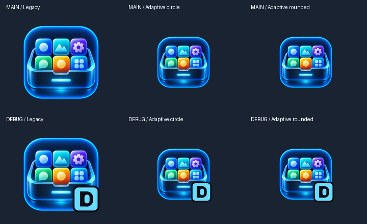

# RS-01 — RobStyle + navegación

## Alcance implementado

Material 3 conserva su comportamiento y accesibilidad, con tema oscuro por defecto:
fondo `#070D18`, superficies `#101C2D`, texto `#E7EFFA` y acento cian `#69DCFF`.
La paleta clara se puede seleccionar explícitamente desde el tema, sin ajustes
persistentes. No se usan colores dinámicos. La ventana nativa también es oscura y las barras
del sistema conservan iconos claros incluso con Android en modo claro. Tipografía sans serif con títulos
marcados, cuerpo de 16 sp y línea de 26 sp; radios de 12/20/28 dp, margen de 24 dp,
espaciado de 16 dp y elevación de tarjeta de 2 dp. No se añaden animaciones o glow
que reduzcan la legibilidad. Falta contrastar la identidad con RobGit: el repositorio
consultado no resultó accesible.

## Pantallas y navegación

Navigation Compose 2.9.6: `home`, `settings`, `app/{appId}`. El identificador de
aplicación se codifica como segmento URI. Home abre Ajustes; Volver y el back de
Android recuperan el destino anterior. La ficha está registrada para RS-02 y se
prueba mediante navegación interna; Home no inventa aplicaciones ni enlaces a
fichas ficticias. No hay barra inferior porque solo existe un destino principal.

Home presenta un catálogo vacío y refresco deshabilitado con explicación. Detalle
prepara icono, nombre, versiones, descripción, novedades y acción deshabilitada,
sin presentar metadatos ficticios como reales. Ajustes presenta cuatro secciones
informativas sin interruptores que aparenten guardar preferencias.

El contenido tiene anchura máxima de 840 dp, margen flexible y desplazamiento
vertical. No hay alturas fijas para texto; botones Material mantienen los mínimos
táctiles. Las acciones tienen etiquetas accesibles; los estados llevan texto,
no solo color. Previews: Home compacta, grande y fuente al 200 %, Detalle,
Ajustes y estados. Pendiente inspección visual en dispositivo.

## Componentes

`RobTopBar`, `RobCard`, `RobPrimaryButton`, `RobSectionHeader` y `RobStatus`.
Este último representa loading con progreso semántico, empty, error con callback
de reintento y success. Los estados no están conectados a red. Disabled se utiliza
en refresco y acción de detalle. Las pruebas verifican render, retorno de Ajustes,
ruta de detalle, estados y callback de reintento.

## Identidades e icono oficial

Release: `es.robertodorado.robstore`, **RobStore**.
Debug: `es.robertodorado.robstore.debug`, **RobStore DEV**.
Se conservan versiones y firma de RS-00 (Release sin firmar).

Fuente oficial del propietario, incorporada desde `main` (commit `71f26a0`):
[`file_000000001b1882119a5d2c4783dea711.png`](../file_000000001b1882119a5d2c4783dea711.png),
1254 × 1254, RGBA, con canal alfa real. SHA-256:
`9e54585ae0604a09c6da0817cb3654d132e80404c2c2b83e7367923f16789ab2`.
Se conserva byte a byte, sin recorte, reinterpretación, cambios de color ni fondo.

`tools/generate_launcher_icons.py` genera 30 PNG con reescalado Lanczos:

- Legacy normal de 48/72/96/144/192 px, manteniendo proporciones y alfa.
- Legacy round, con margen para preservar la composición en máscara circular.
- Foreground adaptive de 108/162/216/324/432 px. Dibujo completo en un cuadrado
  de 46 dp dentro del círculo seguro de 66 dp, también durante movimiento de capas.
- Densidades mdpi, hdpi, xhdpi, xxhdpi y xxxhdpi; mismas escalas en ambas variantes.
- XML normal y round en `mipmap-anydpi-v26`, fondo transparente. No se publica
  una versión monocroma improvisada del PNG multicolor.
- Debug sobreescribe únicamente sus PNG; añade badge cian con D oscura. Release
  contiene el arte oficial sin letras. Los marcadores provisionales se eliminan.

El launcher del dispositivo puede aplicar su propia máscara o superficie. El
margen adaptive prioriza conservar todo el arte; puede verse menor que el icono
legacy normal. La composición no se estira ni se recorta para agrandarla.

Para regenerar o comprobar los píxeles versionados (herramienta de desarrollo,
sin dependencia Python dentro de la app ni modificación de CI):

```sh
python -m pip install Pillow==12.3.0
python tools/generate_launcher_icons.py
python tools/generate_launcher_icons.py --check
```



La comparativa es una simulación de máscaras, no una captura de dispositivo.
Las pruebas Android comprueban fondo transparente, margen seguro y selección del
badge DEV según variante. `--check` verifica todos los canales de los 30 PNG frente
al original. La revisión visual sobre launcher real queda para la auditoría.

Excepciones de lint limitadas a estos recursos: `IconLauncherShape` en los PNG
round legacy (el original es cuadrado y cabe íntegro dentro de un círculo), y
`MonochromeLauncherIcon` en los dos XML (no se deriva una silueta distinta del
original sin aprobación). Se conserva `v26` como excepción de `ObsoleteSdkInt`
en esa carpeta para seleccionar el adaptive sobre los PNG legacy, comprobado
por `LauncherIconTest` en API 28. No se ocultan errores ni otros avisos.

## Validación

Validación local con JDK 17.0.21, SDK 36 y Build Tools 35.0.0:

| Comando | Resultado |
| --- | --- |
| `./gradlew test` | PASS: 26 pruebas (13 por variante), API 28 |
| `./gradlew lint` | PASS: sin errores |
| `./gradlew assembleDebug` | PASS |
| `./gradlew assembleRelease` | PASS: APK sin firmar |

Ejecución conjunta `./gradlew test lint assembleDebug assembleRelease --no-daemon`:
BUILD SUCCESSFUL. Java utilizó el proxy y almacén de confianza del entorno;
no se versionan rutas ni configuración local. `aapt dump badging` confirma nombres,
IDs, versiones y SDK 26/36 en ambos APK. `git diff --check` correcto. La generación `--check` verifica las cinco densidades.
La inspección de las tablas de recursos con `aapt2` y comparación RGBA de los PNG
extraídos de los APK confirma 15 imágenes idénticas a `main` en Release y 15 a
`debug` en DEV (incluidos nombres optimizados en Release); la D no se filtra.

Lint detecta tres avisos `NewerVersionAvailable` sobre Kotlin Android/Compose y
Robolectric, dependencias heredadas; no hay avisos de UI o recursos. Se mantiene
el aviso ya documentado en RS-00 de empaquetado de `libandroidx.graphics.path.so`.
La CI existente sigue ejecutando los cuatro checks; consultar su resultado
remoto en la PR Draft. El bloqueo del archivo oficial está resuelto. Entrega técnica preparada para
auditoría de ChatGPT, sin merge y sin avanzar a RS-02.

## RS-02

Conectar catálogo real y aportar metadatos a la ficha según su alcance aprobado.
RS-01 no incorpora GitHub API, detección de paquetes, descargas, instalación,
trabajos en segundo plano, notificaciones, autenticación ni servicios externos.
